# Arquitetura e fluxos dos algoritmos

Esta página apresenta a estrutura efetivamente implementada em `src/`. Os
diagramas de chamadas e UML são regenerados por análise estática; os fluxos
conceituais foram deliberadamente resumidos para evidenciar decisões do
algoritmo sem reproduzir cada detalhe de instrumentação.

## Visão geral

`tsplib` concentra a leitura e a matriz de custos, reutilizada por todas as
estratégias. `initial_solutions` registra as cinco formas de criar a incumbente
do Branch-and-Bound. As duas aproximações e suas subrotinas compartilhadas
ficam em `approximation`. A execução em lote separa o orquestrador
`experiment_runner` do processo isolado `experiment_worker`, que chama o mesmo
solver usado pela CLI.

### Fluxo geral dos experimentos

Este esquema mostra somente o caminho principal: descobrir as instâncias,
executar cada configuração isoladamente, salvar os artefatos e analisar o CSV
consolidado. Detalhes internos do solver ficam nos fluxos posteriores.

<!-- BEGIN GENERATED: workflow-experiments -->
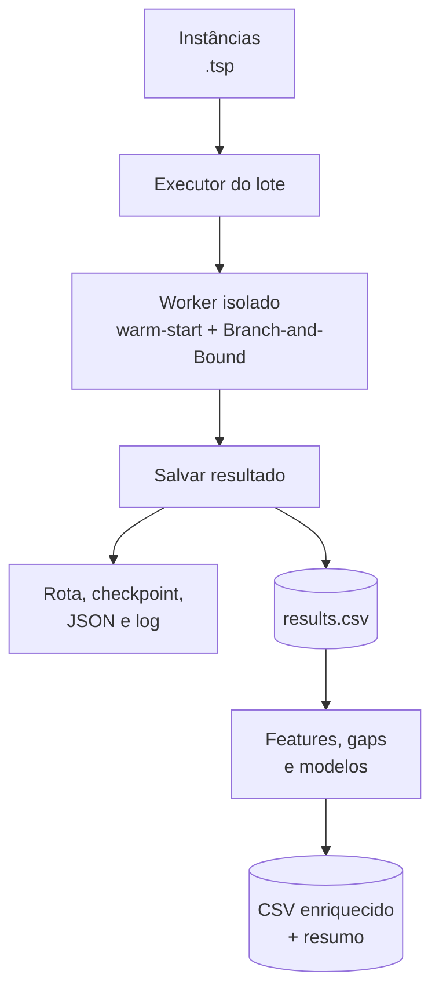
<!-- END GENERATED: workflow-experiments -->

### Dependências entre módulos (Pyreverse)

As setas indicam importações entre módulos do pacote.

<!-- BEGIN GENERATED: uml-modules -->
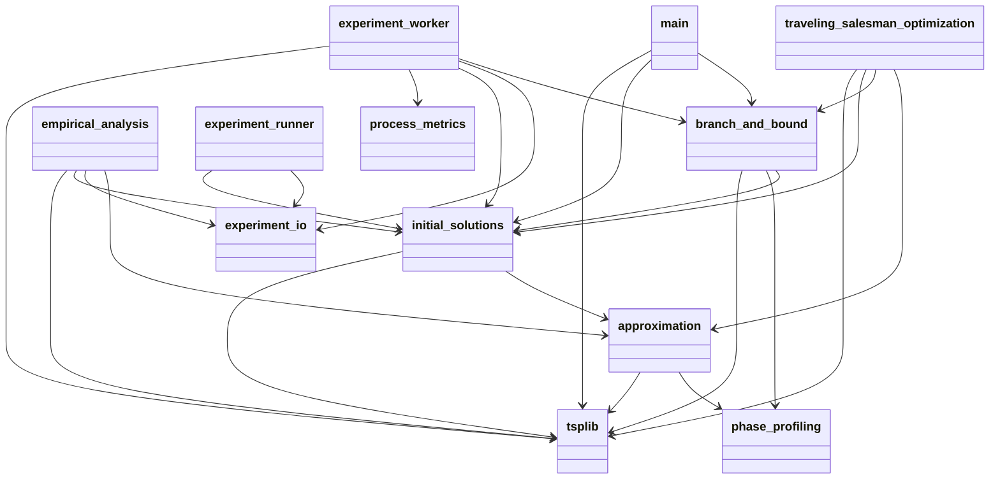
<!-- END GENERATED: uml-modules -->

### Classes e contratos do domínio (Pyreverse)

O recorte se concentra nos três módulos do domínio para manter em foco a
instância TSP, o resultado instrumentado e o contrato substituível das
estratégias iniciais.

<!-- BEGIN GENERATED: uml-classes -->
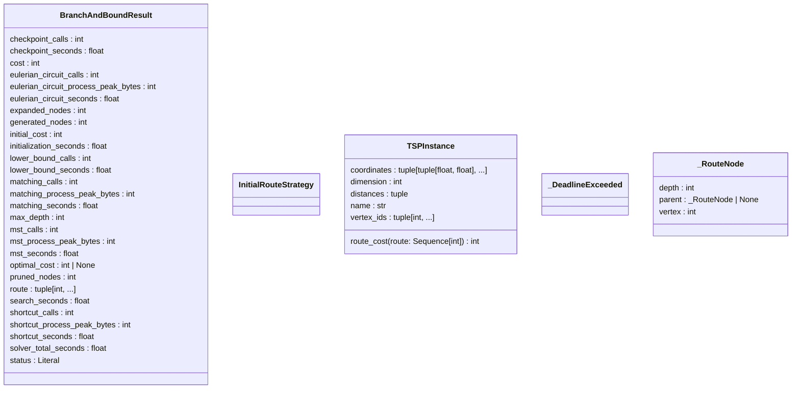
<!-- END GENERATED: uml-classes -->

## Chamadas e reutilização de código

Os grafos abaixo são produzidos pelo Code2flow. Funções de entrada aparecem
em azul. Chamadas repetidas entre o mesmo par são condensadas em uma única
seta e os números de linha são omitidos para reduzir ruído nos diffs.

### Caminho da CLI ao solver

<!-- BEGIN GENERATED: calls-cli -->
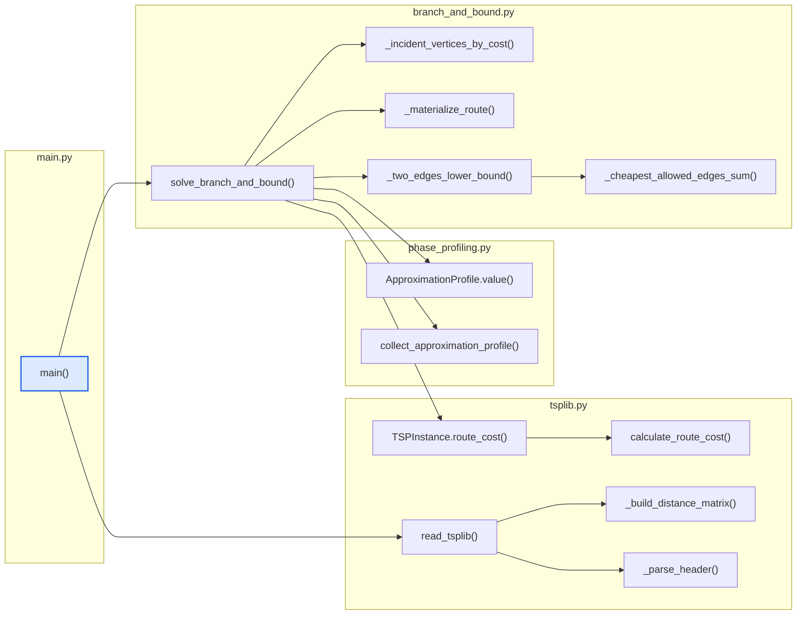
<!-- END GENERATED: calls-cli -->

### Núcleo do Branch-and-Bound

<!-- BEGIN GENERATED: calls-branch-and-bound -->
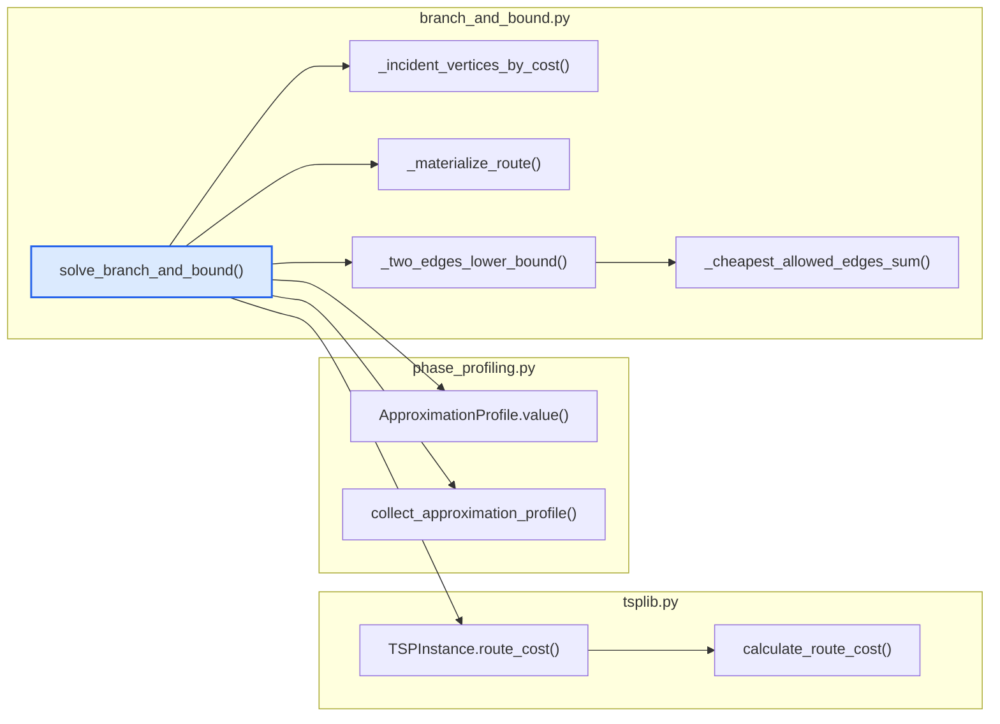
<!-- END GENERATED: calls-branch-and-bound -->

### Chamadas da estratégia trivial

A rota trivial é autocontida; por isso, seu grafo possui apenas a função de
entrada.

<!-- BEGIN GENERATED: calls-strategy-trivial -->
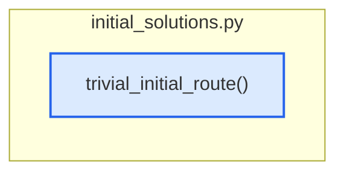
<!-- END GENERATED: calls-strategy-trivial -->

### Chamadas do Vizinho Mais Próximo

O Vizinho Mais Próximo também é autocontido. Operações de coleção e acesso à
matriz não aparecem como funções independentes no Code2flow.

<!-- BEGIN GENERATED: calls-strategy-nearest-neighbor -->
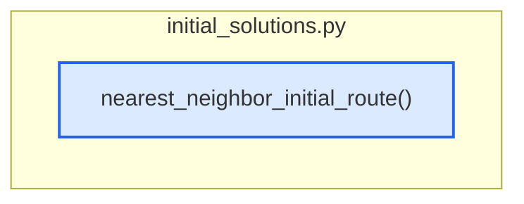
<!-- END GENERATED: calls-strategy-nearest-neighbor -->

### Chamadas da inserção pelo fecho convexo

<!-- BEGIN GENERATED: calls-strategy-convex-hull -->
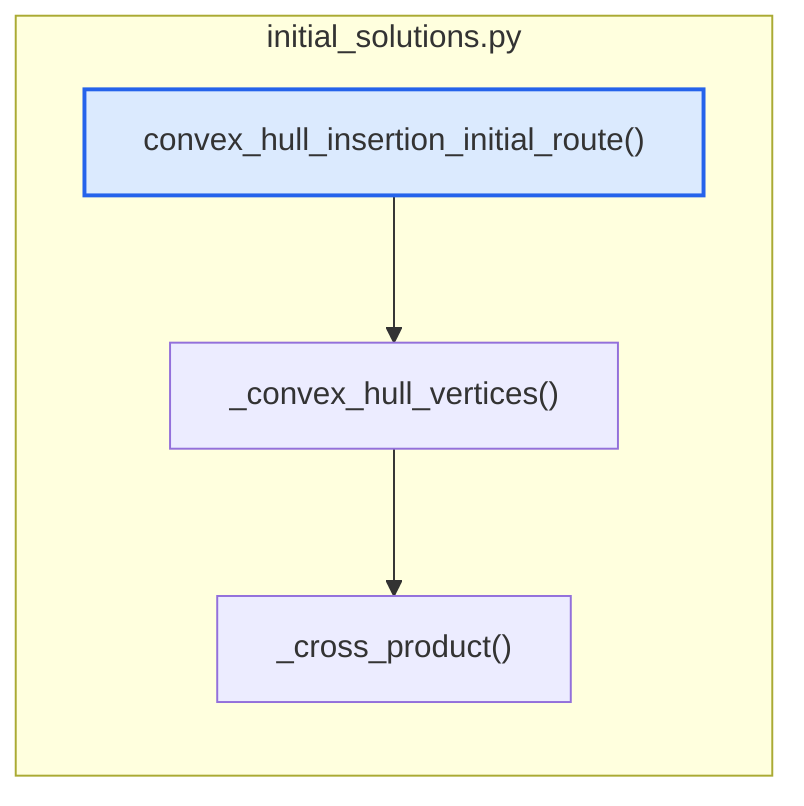
<!-- END GENERATED: calls-strategy-convex-hull -->

### Chamadas de Twice-around-the-tree

<!-- BEGIN GENERATED: calls-strategy-twice-around-tree -->
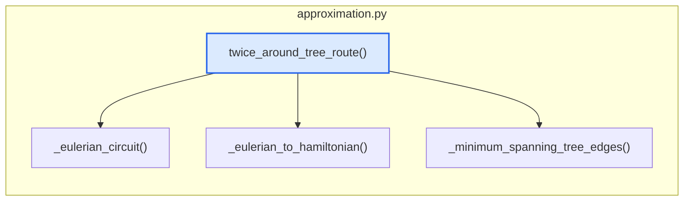
<!-- END GENERATED: calls-strategy-twice-around-tree -->

### Chamadas de Christofides

<!-- BEGIN GENERATED: calls-strategy-christofides -->
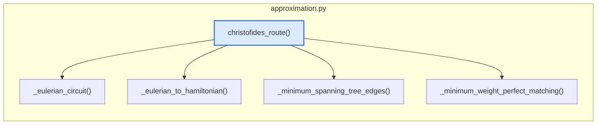
<!-- END GENERATED: calls-strategy-christofides -->

## Fluxos principais

Estes fluxos são uma visão curada da implementação. Eles complementam os
grafos automáticos mostrando laços e decisões que um grafo de chamadas não
representa bem.

### Branch-and-Bound exato

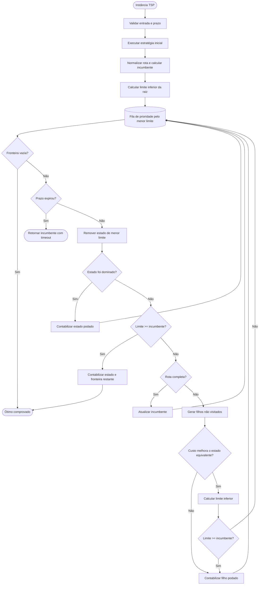

O limite inferior soma as duas arestas incidentes mais baratas ainda
permitidas em cada vértice, respeitando a rota parcial, e divide a soma por
dois. A fila implementa exploração *best-first*. Estados equivalentes mantêm
somente o menor custo parcial, e seus prefixos compartilham nós ligados ao pai;
a rota completa é materializada apenas quando se torna incumbente. Checkpoints
são disparados em pontos cooperativos do laço sem alterar a ordem da busca.
Como a heap remove primeiro o menor limite, quando esse valor já alcança a
incumbente toda a fronteira restante pode ser contabilizada como podada e a
prova termina imediatamente.

### Estratégias de incumbente inicial

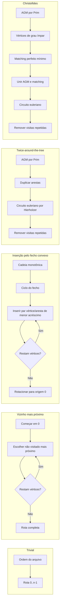

As cinco rotas usam índices internos, começam no índice zero e não repetem a
origem no fim. O solver valida a permutação e calcula o custo pela mesma matriz
`EUC_2D`, evitando divergência entre estratégias.

## Como regenerar

Instale as dependências específicas de documentação no ambiente virtual:

```bash
python -m pip install -e ".[docs]"
```

Para renderizar as figuras PDF usadas em `docs/report/main.tex`, o executável
`dot` do [Graphviz](https://graphviz.org/download/) também deve estar disponível
no `PATH`. Se ele estiver em outro local, informe-o com `--dot CAMINHO`.

Depois de alterar o código em `src/`, execute:

```bash
python scripts/generate_diagrams.py
```

O comando recria os arquivos Mermaid em `docs/diagrams/generated/` e sincroniza
os blocos delimitados por `BEGIN GENERATED` nesta página. As fontes DOT ficam
na mesma pasta e os PDFs do artigo são escritos em `docs/report/figures/`. Não
edite esses blocos ou arquivos gerados manualmente; os fluxos conceituais fora
dos marcadores podem ser ajustados quando uma mudança alterar as etapas do
algoritmo.

Code2flow e Pyreverse fazem análise estática: chamadas dinâmicas por meio do
registro `INITIAL_ROUTE_STRATEGIES` não são inferidas como arestas. Por isso,
cada estratégia possui uma lista explícita de funções no gerador, inclusive as
duas entradas autocontidas. O fluxo geral dos experimentos é conceitual e não é
atribuído ao Code2flow.
